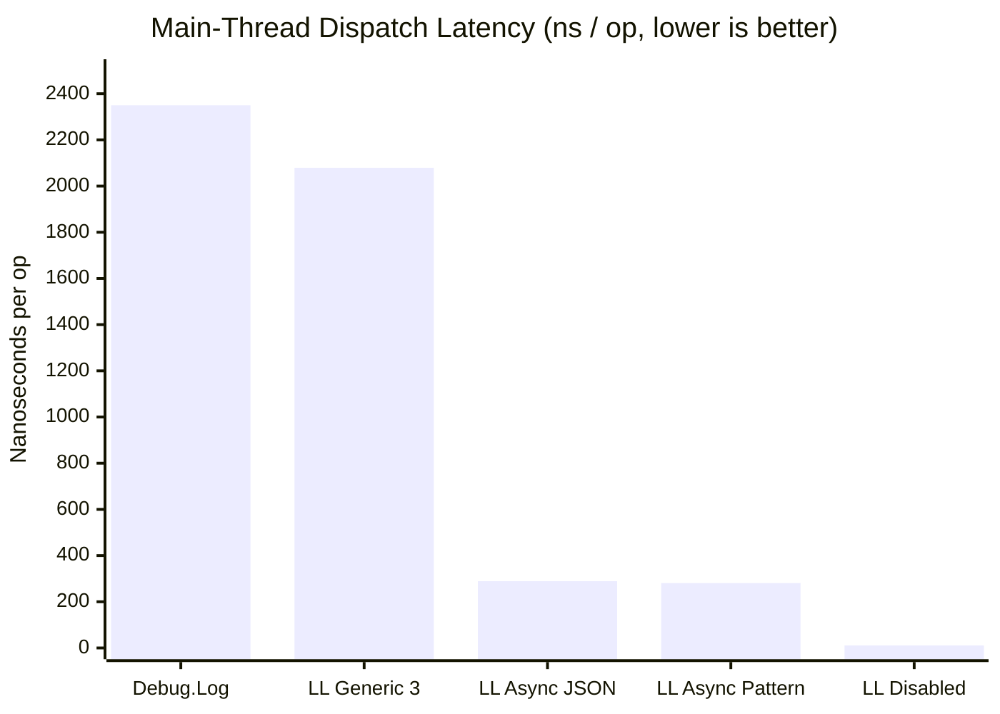
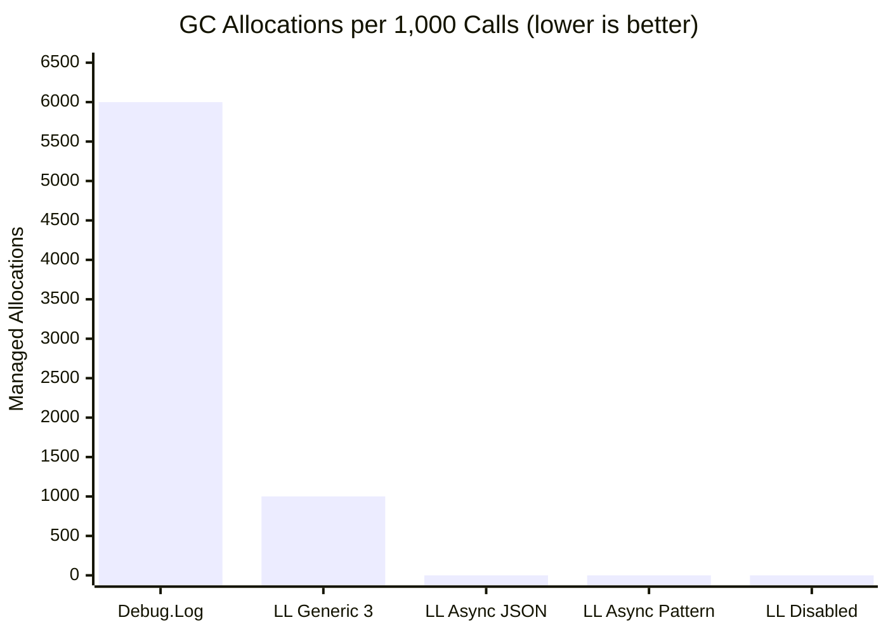
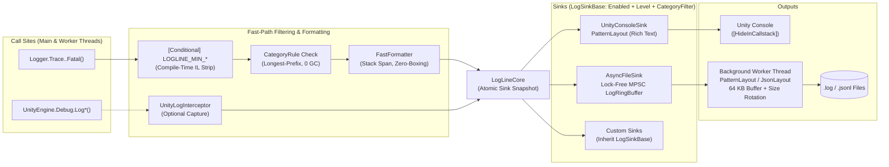

<p align="center">
  
</p>

<p align="center">
  <strong>High-performance, zero-allocation, user-friendly logging framework for Unity.</strong>
</p>

<p align="center">
  <a href="https://unity.com/"></a>
  <a href="LICENSE.md"></a>
  <a href="https://openupm.com/packages/com.mrtorex.logline/"></a>
  <a href="https://github.com/MrTorex/LogLine/releases"></a>
</p>

LogLine replaces ad-hoc `UnityEngine.Debug.Log` wrappers with a structured, lock-free asynchronous pipeline, compile-time call stripping, category-based routing, NDJSON/pattern layouts, and a live UI Toolkit Editor Dashboard — with **0 GC allocations** on hot paths.

---

## Why LogLine?

Standard `UnityEngine.Debug.Log` works for prototypes, but breaks down in production games:

- **Blocking I/O & Stack Traces:** Writing to `Player.log` blocks the caller thread, grows unbounded without rotation, and captures managed stack traces on every call in development builds.
- **GC Spikes:** `string.Format`, string interpolation, and `params object[]` box value types and allocate heap garbage even when logs are filtered out at runtime.
- **No Granular Filtering:** You cannot silence noisy subsystems (`Audio`, `Physics`) while keeping `Combat.AI` at `Trace`, or route structured JSON logs to disk while keeping the Unity Console clean.
- **Broken Double-Click Navigation:** Naive wrapper classes hijack Unity Console double-click, jumping to the wrapper instead of the calling script.

LogLine solves all of these with a lightweight, zero-dependency UPM package built specifically for Unity 2022.3 LTS and newer.

---

## Key Features

- **Zero-Allocation Hot Paths:** `0` GC allocations on disabled levels (including generic primitive arguments), literal dispatches, ring buffer enqueue/dequeue, category filtering, and `Span<char>` layout formatting (even under Mono).
- **Compile-Time Stripping:** `[Conditional]` attributes backed by `LOGLINE_MIN_*` scripting define symbols completely strip low-severity calls — and evaluation of their arguments — from IL in release builds.
- **Lock-Free Async File Sink:** Multi-producer single-consumer (MPSC) ring buffer with background disk I/O, immediate flush on `Error`/`Fatal`, periodic flush on lower levels, and automatic size-based file rotation with archive limits.
- **Hierarchical Categories & Sink Routing:** Longest-prefix category rules (`Combat` → `Combat.AI` → `Combat.AI.Boss`) plus per-sink `AllowList` / `DenyList` filters.
- **Flexible Layouts:** Rich-text / plain `PatternLayout` and RFC 8259 compliant `JsonLayout` (NDJSON) with configurable field toggles and deep `InnerException` chain handling.
- **Unity Console Integration:** Preserves `[HideInCallstack]` double-click navigation and optionally intercepts native `UnityEngine.Debug.Log*` calls via `UnityLogInterceptor`.
- **Live Editor Dashboard & Project Settings:** UI Toolkit window (`Tools → LogLine → Dashboard`) and `Project Settings → LogLine` with live hot-reconfiguration and full support for **Enter Play Mode Options (Domain Reload disabled)**.


---

## Benchmarks

Measured in **Unity 2022.3 LTS (Mono, Editor Play Mode)** across **1,000 operations per scenario** on the main thread using `Stopwatch` and Unity's `Profiler.Recorder("GC.Alloc")` (verified zero harness baseline; async file tests measure caller-thread dispatch without `UnityConsoleSink`).

| Scenario | Total (ms) | ns / op | GC Allocs | Allocs / op | vs `Debug.Log` |
| :--- | ---: | ---: | ---: | ---: | :--- |
| `UnityEngine.Debug.Log(string.Format(...))` | 2.350 | 2,350 | 6,000 | 6.00 | Baseline |
| **LogLine Compile-Time Stripped (`LOGLINE_MIN_*`)** | **0.000** | **0** | **0** | **0.00** | **Removed from IL** |
| **LogLine Disabled (Generic 3 value-type args)** | **0.011** | **11** | **0** | **0.00** | **~213× faster, 0 GC** |
| **LogLine Enabled Literal (Async Pattern)** | **0.281** | **281** | **0** | **0.00** | **~8.4× faster, 0 GC** |
| **LogLine Enabled Literal (Async JSON)** | **0.289** | **289** | **0** | **0.00** | **~8.1× faster, 0 GC** |
| **LogLine Enabled Generic 3 args (Async)** | **2.079** | **2,079** | **1,000** | **1.00** | **6× fewer GC allocs** |

> **Note:** On enabled generic calls with format arguments (`logger.Info("HP={0}", hp)`), `FastFormatter` formats primitives on the stack with zero boxing; the single remaining allocation is the final `string` stored in `LogEvent.Message`. In development builds with stack traces enabled, native `Debug.Log` typically slows down to tens of microseconds per call, widening the gap further.





---

## Installation

### Option 1: OpenUPM (Recommended)

```bash
openupm add com.mrtorex.logline
```

### Option 2: Unity Package Manager (Git URL)

1. Open **Window → Package Manager**.
2. Click **+** → **Add package from git URL...**.
3. Enter:
```text
https://github.com/MrTorex/LogLine.git
```


### Option 3: Manual `manifest.json`

Add the entry to `Packages/manifest.json`:

```json
{
  "dependencies": {
    "com.mrtorex.logline": "https://github.com/MrTorex/LogLine.git"
  }
}
```

### Importing Samples

After installation, open **Window → Package Manager**, select **LogLine**, open the **Samples** tab, and click **Import** next to **Basic Usage**. Open the imported `BasicUsage` scene and enter Play Mode to test category logging, exception capture, custom sinks, and NDJSON routing interactively.

---

## Quickstart

LogLine auto-initializes before the first scene loads using your settings asset (configure it anytime via **Tools → LogLine → Dashboard** or **Edit → Project Settings → LogLine**).

```csharp
using System;
using UnityEngine;
using Log = LogLine.LogLine;
using Logger = LogLine.Core.Logger;

namespace MyGame.Combat
{
    public class EnemyAI : MonoBehaviour
    {
        // Cache a category logger once (zero allocations on subsequent calls)
        private static readonly Logger LogAI = Log.GetLogger<EnemyAI>();

        private void OnHit(int entityId, float damage, bool isCrit)
        {
            // Zero-boxing generic formatting (up to 3 arguments)
            LogAI.Info("Entity #{0} took {1} damage (crit={2}).", entityId, damage, isCrit);

            // Or log directly through the global facade without declaring a category
            Log.Debug("Combat tick processed.");
            Log.Global.Info("Wave state updated.");
        }

        private void OnFault(Exception ex)
        {
            // Captures exception type, message, stack trace, and inner exceptions
            LogAI.Error(ex, "AI state transition failed.");
        }
    }
}
```

---

## Architecture



---

## Log Levels & Compile-Time Stripping

LogLine provides six severity levels plus `None` to disable output entirely:

| Level | Compile-Time Define | Typical Use Case |
| :--- | :--- | :--- |
| `Trace` | `LOGLINE_MIN_TRACE` *(default)* | Per-frame diagnostics, fine-grained state transitions |
| `Debug` | `LOGLINE_MIN_DEBUG` | Development diagnostics, lifecycle events |
| `Info` | `LOGLINE_MIN_INFO` | High-level milestones (scene loads, session start) |
| `Warn` | `LOGLINE_MIN_WARN` | Recoverable anomalies, fallback paths, jitter spikes |
| `Error` | `LOGLINE_MIN_ERROR` | Failures, caught exceptions, broken invariants |
| `Fatal` | `LOGLINE_MIN_FATAL` | Unrecoverable errors before shutdown |
| `None` | `LOGLINE_MIN_NONE` | Completely strips all logging calls from builds |

### Compile-Time Stripping (`[Conditional]`)

Unlike runtime `if` guards, LogLine decorates level methods with `[Conditional]` attributes linked to `LOGLINE_MIN_*` scripting defines. When you set `LOGLINE_MIN_WARN` in **Player Settings → Scripting Define Symbols** (or via **Tools → LogLine → Dashboard → Compilation**), the C# compiler strips all `Trace`, `Debug`, and `Info` calls — **including evaluation of their arguments** — directly out of IL:

```csharp
// Under LOGLINE_MIN_WARN, neither the call nor ComputeDebugSummary() exists in the compiled build.
LogAI.Debug("Pathfinding summary: {0}", ComputeDebugSummary());
```

You can inspect the active compiled threshold at runtime via `LogLineDefines.CompiledMinimumLevel`.

> **Tip:** Always store logger references as the concrete `LogLine.Core.Logger` type (or call static `LogLine.*` facade methods) to benefit from full `[Conditional]` call-site and argument stripping. Calls invoked through the `ILogger` interface still skip execution below `CompiledMinimumLevel`, but the compiler cannot strip argument evaluation at the call site.

---

## Loggers, Categories & Hierarchical Rules

Obtain a cached `Logger` once per class or subsystem. Calling `GetLogger` returns the same tracked instance, so `static readonly` fields remain valid across hot reloads and **No-Domain-Reload** Play Mode restarts.

```csharp
using Log = LogLine.LogLine;
using Logger = LogLine.Core.Logger;

// Named by type short name (e.g., "EnemyAI")
private static readonly Logger TypeLog = Log.GetLogger<EnemyAI>();

// Explicit hierarchical category
private static readonly Logger CombatLog = Log.GetLogger("Combat.AI.Boss");

// Shared global logger
Log.Global.Info("Application initialized.");
```

### Longest-Prefix Category Rules

Category rules resolve case-insensitively using **longest-prefix matching**:

```text
Global Minimum Level: Info
Rule 1: "Combat"        -> Warn
Rule 2: "Combat.AI"     -> Trace
```

* `Audio.Mixer` → uses `Info` (Global fallback)
* `Combat.Weapons` → matches `"Combat"` → `Warn`
* `Combat.AI.Boss` → matches `"Combat.AI"` (more specific than `"Combat"`) → `Trace`

Changing rules in the Dashboard or calling `Log.ApplySettings(settings)` updates `Logger.MinimumLevel` on every active logger atomically at runtime.

---

## Zero-Allocation Formatting & Exceptions

To avoid `params object[]` array allocations and value-type boxing, `Logger` exposes generic overloads for up to 3 arguments backed by stack-allocated `Span<char>` formatting:

```csharp
// 0 GC allocations when disabled; 0 boxing when enabled
LogAI.Info("HP: {0}, Speed: {1}, Grounded: {2}", hp, speed, isGrounded);

// 0 GC allocations on caller thread even when enabled (AsyncFileSink)
LogAI.Info("Wave completed.");

// Exception logging (captures type, message, stack trace, and inner exception chain)
try
{
    ProcessPacket(buffer);
}
catch (Exception ex)
{
    LogAI.Error(ex, "Packet processing failed.");
    //or
    LogAI.Error(ex, "Packet #{0} processing failed.", packetId);
}
```

---

## Sinks & Category Routing

Every built-in and custom sink inherits from `LogSinkBase`, which provides thread-safe:

* `IsEnabled` toggle
* `MinimumLevel` threshold
* `CategoryFilter` (`None`, `AllowList`, or `DenyList`)
* Fault isolation (an exception inside one sink never interrupts sibling sinks)

### Built-In Sinks

#### 1. `UnityConsoleSink`
Outputs formatted events to Unity's Console using `[HideInCallstack]` so double-clicking a log entry jumps straight to your script instead of LogLine internals. Supports optional Unity rich-text coloring via `PatternLayout`.

#### 2. `AsyncFileSink`
Writes formatted logs on a dedicated background thread fed by a lock-free MPSC `LogRingBuffer` with a 64 KB `StreamWriter` buffer:

* **Flush Policy:** Flushes immediately on `Error` and `Fatal`, periodically (every 500 ms) on lower levels, and drains cleanly on `Dispose()` / application quit.
* **Overflow Accounting:** Never blocks the game thread if disk I/O stalls; drops excess entries safely and records them in `DroppedCount` (plus emits a warning entry when space recovers).
* **Size-Based Rotation:** Rotates files automatically when `MaxFileSizeBytes` is reached, retaining up to `MaxArchiveFiles` archives (`game.log.1`, `game.log.2`, ...). Set `MaxArchiveFiles = 0` to truncate/replace without archives.

```csharp
using LogLine.Core;
using LogLine.Layouts;
using LogLine.Sinks;
using Log = LogLine.LogLine;

var combatFileSink = new AsyncFileSink(
    filePath: "{persistentDataPath}/Logs/combat_{date}.jsonl",
    layout: new JsonLayout(appendNewline: true),
    ringBufferCapacity: 4096)
{
    MinimumLevel = LogLevel.Debug,
    MaxFileSizeBytes = 10 * 1024 * 1024, // 10 MB
    MaxArchiveFiles = 5,
    CategoryFilter = CategoryFilter.Allow("Combat", "Network")
};

Log.AddSink(combatFileSink);

// Detach and flush cleanly when no longer needed
Log.RemoveSink(combatFileSink);
```

### Sink-Level Category Filters

```csharp
// Pass everything (default)
sink.CategoryFilter = null;

// Only accept events from "Combat" or "Network" (and their sub-categories)
sink.CategoryFilter = CategoryFilter.Allow("Combat", "Network");

// Accept everything except "Audio" and "Unity"
sink.CategoryFilter = CategoryFilter.Deny("Audio", "Unity");
```

### Creating a Custom Sink

Inherit from `LogSinkBase` to build in-game consoles, crash-report buffers, or remote telemetry sinks:

```csharp
using System;
using LogLine.Core;
using LogLine.Layouts;

public sealed class TelemetrySink : LogSinkBase
{
    private readonly ILogLayout _layout = new JsonLayout(appendNewline: false);

    public override string Name => "Telemetry";

    protected override void Write(in LogEvent logEvent)
    {
        Span<char> buffer = stackalloc char[1024];
        if (_layout.TryFormat(in logEvent, buffer, out int written))
        {
            SendPayload(buffer[..written]);
        }
    }

    protected override void OnDispose()
    {
        // Flush or close remote transport here
    }

    private void SendPayload(ReadOnlySpan<char> json) { /* ... */ }
}
```

---

## Layouts

### `PatternLayout`

Compiles a pattern string once into zero-allocation `Span<char>` converters (including a custom zero-alloc date writer that avoids Mono's `DateTime.TryFormat` allocations).

| Token | Output |
| :--- | :--- |
| `%d` | Local timestamp using default format (`yyyy-MM-dd HH:mm:ss.fff`) |
| `%d{format}` | Local timestamp with custom format (e.g., `%d{HH:mm:ss.fff}`, `%d{yyyy-MM-dd HH:mm:ss.fff}`) |
| `%p` | Severity level (`TRACE`, `DEBUG`, `INFO`, `WARN`, `ERROR`, `FATAL`) |
| `%c` | Logger category name (e.g., `Combat.AI`) |
| `%m` | Log message |
| `%t` | Managed thread ID |
| `%ex` | Exception details and stack trace (omitted when no exception is attached) |
| `%n` | Line feed character (`'\n'`) |
| `%%` | Literal `%` character |

```csharp
// Plain file pattern
var fileLayout = new PatternLayout(PatternLayout.DefaultFilePattern, useColorTags: false);

// Console pattern with Unity rich-text colors
var consoleLayout = new PatternLayout("[%d{HH:mm:ss.fff}] [%p] [%c] %m%ex", useColorTags: true);
```

### `JsonLayout` (NDJSON)

Serializes events into RFC 8259 compliant newline-delimited JSON with zero heap allocations on the formatting path. Safely escapes control characters (`\0`–`\u001F`), quotes, backslashes, and newlines, and serializes nested `InnerException` chains with depth bounds.

```json
{"timestamp":"2026-04-12T18:42:05.123Z","level":"ERROR","logger":"Network.Sync","message":"Failed to decode inbound packet.","threadId":1,"exception":"System.InvalidOperationException: Malformed header\n   at ..."}
```

Configure optional fields (`includeTimestamp`, `includeLevel`, `includeLogger`, `includeThreadId`, `includeException`) via `JsonLayoutConfig` in `LogLineSettings` or in code.

---

## File Path Macros (`FilePathResolver`)

`AsyncFileSink` expands path macros once at construction via `FilePathResolver.Resolve`. Relative paths (such as `"game.log"`) are automatically rooted under `{persistentDataPath}/Logs/`.

| Macro | Expanded Value |
| :--- | :--- |
| `{persistentDataPath}` | `Application.persistentDataPath` |
| `{dataPath}` | `Application.dataPath` *(may be read-only on mobile/console builds)* |
| `{temporaryCachePath}` / `{tempPath}` | `Application.temporaryCachePath` |
| `{streamingAssetsPath}` | `Application.streamingAssetsPath` *(may be read-only on mobile/console builds)* |
| `{projectPath}` | Project root in Editor / parent directory of `dataPath` in builds |
| `{consoleLogPath}` | Directory containing Unity's `Application.consoleLogPath` |
| `{productName}` | Filename-sanitized `Application.productName` |
| `{companyName}` | Filename-sanitized `Application.companyName` |
| `{version}` | Filename-sanitized `Application.version` |
| `{platform}` | `Application.platform` name (e.g., `WindowsPlayer`, `Android`) |
| `{pid}` | Current OS process ID |
| `{date}` / `{time}` / `{datetime}` | Local date (`yyyy-MM-dd`), time (`HH-mm-ss`), or combined (`yyyy-MM-dd_HH-mm-ss`) |
| `{utcDate}` / `{utcTime}` / `{utcDatetime}` | Same aliases formatted in UTC |
| `{date:format}` / `{utcDate:format}` | Custom .NET `DateTime` format in local time or UTC (e.g., `{utcDate:yyyy-MM-dd_HH-mm}`) |
| `{yyyy-MM-dd_HH-mm-ss}` | Bare custom .NET `DateTime` format in local time |
| `{{` / `}}` | Escaped literal `{` and `}` characters |

Default template: `"{persistentDataPath}/Logs/game.log"`.

---

## Configuration, Unity Interception & Editor Tools

### Editor Dashboard & Project Settings

* **Tools → LogLine → Dashboard** — Live UI Toolkit window for editing global level, console/file sink settings, pattern/JSON layouts, category rules, and `LOGLINE_MIN_*` scripting define symbols.
* **Edit → Project Settings → LogLine** — Embedded Project Settings provider pointing to the same `LogLineSettings` asset.

### Programmatic Initialization & Hot-Swap

By default, LogLine initializes automatically via `[RuntimeInitializeOnLoadMethod]` using your `LogLineSettings` asset. You can also initialize or hot-swap configuration manually:

```csharp
// Manual initialization (when autoInitialize is disabled)
Log.Initialize(mySettings);

// Apply updated levels, category rules, sink filters, layouts, or interceptor toggle at runtime
mySettings.globalMinimumLevel = LogLevel.Warn;
Log.ApplySettings(mySettings);
```

### Intercepting Native `UnityEngine.Debug.Log*`

Enable **Intercept Unity Logs** in `LogLineSettings` (or the Dashboard) to route native Unity engine logs and third-party plugin `Debug.Log` / `LogWarning` / `LogError` calls into LogLine under the `"Unity"` category so they are captured by `AsyncFileSink` and custom sinks. Inspect runtime status via `Log.IsInterceptorActive`.

---

## Lifecycle & Platform Notes

* **Enter Play Mode Options (No Domain Reload):** LogLine resets sink pipelines cleanly between Play Mode sessions while preserving `static readonly Logger` references and re-applying updated rules automatically.
* **WebGL:** WebGL does not support background `System.Threading.Thread` workers or standard local disk I/O. Disable `enableFileLogging` (or guard `AsyncFileSink` with `#if !UNITY_WEBGL || UNITY_EDITOR`) for WebGL targets; `UnityConsoleSink` and custom sinks work normally.
* **IL2CPP & Mobile:** All runtime types are AOT-friendly with no runtime reflection or `System.Reflection.Emit`.
* **Security:** LogLine never evaluates expressions or lookups inside log messages (immune to Log4Shell-style injection). When logging untrusted user input to disk, prefer `JsonLayout` to prevent newline-based log forging.

---

## Contributing & License

Contributions, bug reports, and feature requests are welcome — please see [CONTRIBUTING.md](CONTRIBUTING.md) and [CODE_OF_CONDUCT.md](CODE_OF_CONDUCT.md).

Licensed under the [MIT License](LICENSE.md).
